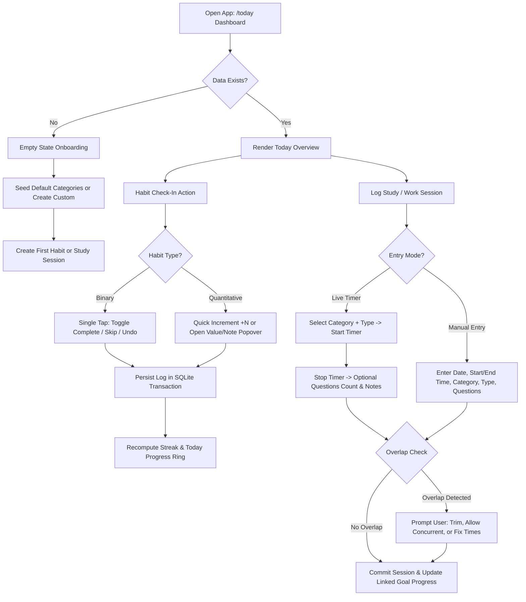
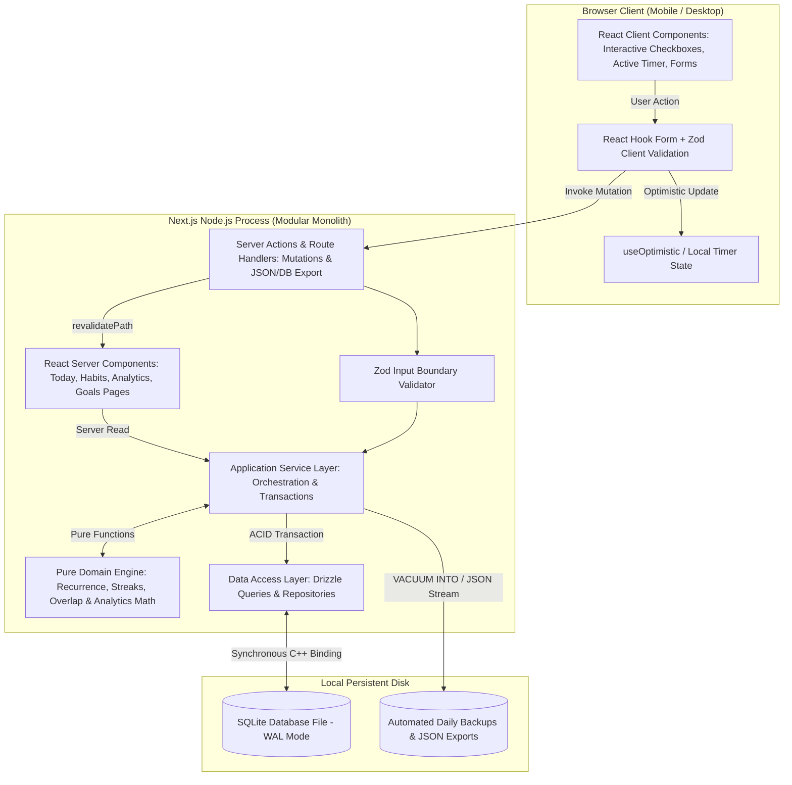
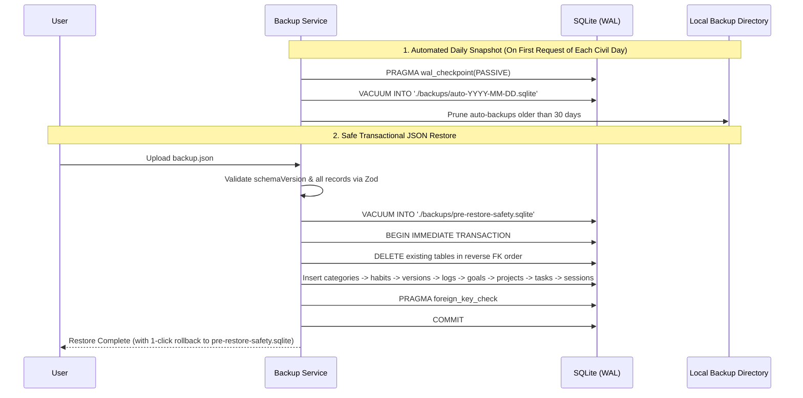

# Design Specification: Personal Habit Tracking & Productivity Dashboard

## 1. Executive Summary

### 1.1 Product Definition
The **Personal Habit Tracking & Productivity Dashboard** is a single-user, mobile-first web application designed to plan, record, and analyze daily habits, structured academic/technical work sessions, personal projects, and measurable long-term goals. It provides deterministic streak tracking, transparent analytics, and bilingual bidirectional support (English LTR and Persian RTL) without the overhead of multi-user SaaS infrastructure.

### 1.2 Target User & Primary Use Cases
The system is architected exclusively for a single technical user balancing rigorous academic preparation and software/AI engineering:
1. **Academic Studies**: Grade 11 mathematics and physics curriculum, university entrance exam preparation (Konkur/standardized testing), specialized coursework, timed practice question sets, error-review sessions, and mock exams.
2. **AI Engineering**: Machine learning, deep learning, speech AI, multi-agent architectures, literature review, and experimental research projects.
3. **Programming & Development**: Algorithmic coding practice, full-stack/systems software projects, technical skill acquisition, and milestone tracking.
4. **Personal Development**: English proficiency practice, physical conditioning, sleep schedule consistency, and custom lifestyle habits.

All life areas (categories) are user-configurable entities rather than hardcoded enums, supporting full creation, renaming, color/icon customization, reordering, archival, and deletion.

### 1.3 Architectural Philosophy & Recommended Stack
The system follows a **Local-First / Single-Node Modular Monolith** architecture:
- **Application Framework**: Next.js (App Router) with React and strict TypeScript.
- **Domain Isolation**: Pure, zero-dependency TypeScript domain engines for recurrence evaluation, streak state machines, session overlap resolution, and analytics formulas—completely decoupled from React components and database drivers.
- **Persistence**: Single-file SQLite database running in Write-Ahead Logging (WAL) mode via `better-sqlite3` and Drizzle ORM, guaranteeing ACID transactions, zero network latency between app and database, effortless single-file backups (`VACUUM INTO`), and strict schema migrations.
- **Styling & UI**: Mobile-first Tailwind CSS with logical layout properties (`ms-*`, `me-*`, `ps-*`, `pe-*`) for native LTR/RTL mirroring, paired with accessible Radix UI / shadcn/ui primitives.

---

## 2. Requirements Specification

### 2.1 Scope Control & Feature Triage

| Tier | Feature Set | Value vs. Implementation Cost Justification |
| :--- | :--- | :--- |
| **1. Essential (MVP / v1.0)** | Configurable categories; binary & quantitative habits; 4 schedule types (daily, selected weekdays, weekly target, custom interval); historical log editing with target snapshotting; deterministic streak engine; lightweight study/work session logger (manual & active timer); goals & lightweight projects/tasks; core analytics dashboard; English (LTR) & Persian (RTL) UI with explicit Gregorian/Solar Hijri calendar support; JSON export/import & SQLite backup. | **High Value / Moderate Cost:** Directly satisfies all core tracking, academic/AI study logging, and analytical requirements with zero external service dependencies. |
| **2. Useful but Deferrable (v1.1+)** | In-app browser notification API reminders (Notification API while tab/PWA is open); Pomodoro countdown mode inside the session timer; keyboard command palette (Cmd+K / Ctrl+K) on desktop; CSV export for individual habit tables; customizable dashboard widget ordering. | **Moderate Value / Low-to-Moderate Cost:** Enhances convenience on desktop and during timed study sessions, but is non-blocking for daily data capture and accuracy. |
| **3. Explicitly Out of Scope** | Multi-tenancy, user accounts/roles, team workspaces, OAuth/SSO, billing/subscriptions, social leaderboards, AI-generated coaching/insights, third-party calendar/Notion/GitHub sync, WebPush background notification servers, microservices, Redis/queues, gamification (XP, avatars, badges), and opaque "productivity scores." | **Zero/Negative Value / High Cost:** Introduces maintenance burden, attack surface, infrastructure cost, and visual noise for a single-user tool. |

### 2.2 Functional Requirements (FR)
- **FR-CAT (Categories)**: Create, read, update, reorder (`sort_order`), archive, and delete categories. Deleting a category requires either reassigning linked entities or blocking deletion if active records exist (`RESTRICT` on delete unless archived).
- **FR-HAB (Habits)**: Support `BINARY` (done/not done) and `QUANTITATIVE` (numeric progress against a target value and unit such as minutes, questions, pages, or sessions) habits. Support states: `ACTIVE`, `PAUSED`, and `ARCHIVED`.
- **FR-SCH (Schedules)**: Support `DAILY`, `WEEKDAYS` (bitmask/array of days 0–6), `WEEKLY_TARGET` ($K$ completions per 7-day week), and `INTERVAL` (every $N$ days anchored to `start_date`). Schedule and target changes must be versioned by effective date so historical logs are never retroactively invalidated unless explicitly requested.
- **FR-LOG (Habit Logs)**: Record `COMPLETED`, `PARTIAL`, `SKIPPED`, or `MISSED` states per civil date (`YYYY-MM-DD`), along with quantitative value, optional notes, and snapshotted target metadata. Support retrospective creation, editing, and deletion of past dates with immediate deterministic recalculation of streaks and analytics.
- **FR-STR (Streaks)**: Compute Current Streak, Longest Streak, and Weekly Completion Rate according to explicit timezone-safe, DST-safe rules. Unscheduled days, `SKIPPED` logs, and `PAUSED` date ranges never break streaks. The current civil day never breaks a streak while in progress.
- **FR-GOL (Goals & Projects)**: Track Goals with `ACTIVE`, `COMPLETED`, `PAUSED`, and `ABANDONED` statuses and measurable targets. Allow Goal progress to be either manually updated or automatically derived from linked Habit logs, Study/Work sessions, or Project tasks to eliminate duplicate data entry. Support Projects with two-level tasks (Tasks and Subtasks), priority levels (`LOW`, `MEDIUM`, `HIGH`, `CRITICAL`), and optional deadlines.
- **FR-SES (Study & Work Sessions)**: Log focused sessions by category, optional project/goal link, session type (`STUDY`, `PRACTICE_QUESTIONS`, `ERROR_REVIEW`, `CODING`, `RESEARCH`, `MOCK_EXAM`), `start_time`, `end_time`, `duration_minutes`, optional `questions_completed`, and notes. Reject negative/zero durations and sessions exceeding 16 hours. Detect overlapping time intervals and require explicit resolution (reject, trim/split, or confirm concurrent exclusion from net focus time).
- **FR-ANA (Analytics)**: Compute daily/weekly completion rates, habit-specific historical trends, week-over-week deltas, category time distributions, practice question volume, goal progress velocity, and consistently missed scheduled habits using explicit formulas and denominators.

### 2.3 Non-Functional Requirements (NFR)
- **NFR-PERF**: Mobile First Contentful Paint (FCP) under 1.0s and Interaction to Next Paint (INP) under 100ms on local hardware; habit toggle feedback in under 50ms via optimistic UI update backed by local SQLite transaction.
- **NFR-REL**: ACID-compliant local persistence. Zero data loss across browser refreshes, process restarts, or power interruptions (SQLite WAL mode with `synchronous = NORMAL` or `FULL`).
- **NFR-I18N**: Full layout mirroring between English (`dir="ltr"`) and Persian (`dir="rtl"`). Unambiguous storage of UTC timestamps and ISO-8601 civil dates (`YYYY-MM-DD`), with explicit toggle between Solar Hijri (Jalali) and Gregorian display calendars.
- **NFR-A11Y**: WCAG 2.2 Level AA compliance, including minimum 4.5:1 text contrast, 3:1 UI component contrast, minimum $44 \times 44\text{ px}$ mobile touch targets, full keyboard operability, and non-color-only status indicators.

### 2.4 Resolution of Ambiguities & Architectural Assumptions

| Ambiguity / Tension | Explicit Resolution & Architectural Default |
| :--- | :--- |
| **Editing a habit's target or schedule after logging history** | Naive updates corrupt history (e.g., increasing a habit target from 30 to 60 minutes would make past 30-minute completions look incomplete). Resolution: Store `target_value_snapshot` and `was_scheduled_snapshot` on every `habit_log`, and maintain `habit_schedule_versions` with `effective_from_date` and `effective_to_date`. Edits apply from today forward by default, with an explicit checkbox if the user wants to rewrite past history. |
| **Quantitative habit partial completion & streak impact** | What if a user completes 20/40 practice questions on a scheduled day? Resolution: The log is saved with `value = 20` and `status = 'PARTIAL'`. For Streak calculations, a scheduled occurrence only advances the streak if `value >= target_value` (`status = 'COMPLETED'`), unless the user explicitly marks the remainder as SKIPPED (excused). For Analytics, both strict binary completion rate and proportional quantitative fulfillment rate ($\min(1, \text{value}/\text{target})$) are displayed. |
| **Day boundary for late-night study sessions** | Students and engineers frequently study past midnight (e.g., 01:00 AM). Resolution: Introduce a configurable `day_rollover_hour` in `app_preferences` (default 04:00 local time, configurable 00:00–06:00). Any habit check-in prior to `day_rollover_hour` defaults to the logical "today" of the waking day. Study sessions spanning midnight are attributed to the civil date of their `start_time` (or optionally split at the rollover boundary). |
| **Single-user deployment environment** | Unknown whether the user will run the app exclusively on localhost or on a home server/VPS accessed from a phone. Resolution: Design the persistence and app layer identically for a single Node.js process + local SQLite volume, and provide an environment-variable toggle (`AUTH_MODE=none` vs `AUTH_MODE=passphrase`). |

---

## 3. Information Architecture

### 3.1 Navigation Structure
To optimize one-handed mobile ergonomics while supporting desktop productivity, the application uses a 5-destination primary navigation model:
- **Mobile (Viewport width less than 768px)**: Fixed bottom navigation bar (height: 64px + env(safe-area-inset-bottom)) with 4 primary tabs (Today, Habits, Focus & Work, Analytics) and 1 Goals & Projects tab, plus a top header icon for Settings & Backups. A Floating Action Button (FAB) or bottom quick-bar triggers immediate session logging or task creation.
- **Desktop (Viewport width at least 768px)**: Persistent left sidebar (`dir="ltr"`) or right sidebar (`dir="rtl"`) (width: 240px) containing the 5 primary routes, active session timer mini-widget, quick language/calendar switcher, and direct link to Settings & Data Management.

### 3.2 Page Hierarchy & Route Map
```text
/ (Root redirects or renders Today Dashboard)
├── /today             # Daily command center: scheduled habits, active timer, due tasks, daily summary
├── /habits            # Habit directory (Active, Paused, Archived) + weekly matrix view
│   ├── /habits/new    # Create habit sheet/page
│   └── /habits/[id]   # Habit detail: calendar heatmap, streak stats, log history editor, schedule versions
├── /focus             # Study & Work Session tracker (live timer + manual log entry + daily/weekly log table)
├── /goals             # Goals & Projects overview
│   ├── /goals/[id]    # Goal detail & linked habits/sessions/projects progress
│   └── /projects/[id] # Project view with two-level task list & priorities
├── /analytics         # Multi-dimensional charts, category breakdown, missed-habit diagnostics
└── /settings          # Categories CRUD, Locale/Calendar (EN/FA, Gregorian/Jalali), Rollover Hour, Backup/Restore
```

### 3.3 Core User Flows


---

## 4. UI and UX Specification

### 4.1 Mobile-First & Responsive Desktop Layouts

#### Mobile Layout (width < 768px)
- **Single-Column Vertical Stack**: Maximum 1 card per row (padding: 16px, gap: 12px).
- **Top Header (56px)**: Current date in active calendar system (plus secondary badge for alternate calendar if enabled), quick day-stepper (Prev Day, Today, Next Day), and Settings icon.
- **Summary Strip**: Compact 2-column metric bar showing:
  1. Today's Habits: Progress bar + 5 / 7 (71%) + active streak summary.
  2. Focused Time Today: 3h 45m + 65 questions solved.
- **Primary Action Zone (Thumb Zone)**:
  - **Today's Scheduled Habits List**: Grouped by Category or Time-of-Day. Each habit row (min-height: 60px) exposes:
    - Left (LTR) / Right (RTL): Category color indicator + Habit Name + Schedule/Streak pill (🔥 12d or Best: 21d) + quantitative progress (25 / 40 questions).
    - Right (LTR) / Left (RTL): Single-tap 44x44px check button for binary habits, or + quick-log button for quantitative habits. Swiping or tapping the overflow menu (...) reveals Skip (Excuse), Add Note, and Edit Value.
  - **Due & High-Priority Tasks**: Compact collapsible section showing tasks due today/overdue and top 3 priority project tasks.
  - **Weekly Completion & Focus Mini-Chart**: Single dual-purpose bar strip showing the last 7 days of completion rate and study hours without requiring horizontal scrolling.

#### Desktop Layout (width >= 768px and width >= 1280px)
- **12-Column CSS Grid** (max-width: 1440px, gap: 20px, padding: 24px):
  - **Left/Start Column (7 cols)**: Today's Scheduled Habits (with inline numeric stepper inputs and visible note badges) + Upcoming Project Tasks.
  - **Right/End Column (5 cols)**: Active/Quick Study Session Logger widget, Daily/Weekly Focus Summary Card, Active Goals Progress Bars, and 7-Day Streak Matrix.

### 4.2 Visual System

#### Color Palette & Semantic Tokens (CSS Variables / Tailwind)
Designed for high legibility, zero decorative gradients, and strict WCAG 2.2 AA contrast ratios:

| Token Role | Light Theme (`:root`) | Dark Theme (`.dark`) | Contrast Ratio & Usage |
| :--- | :--- | :--- | :--- |
| `--bg-canvas` | `#F8FAFC` (Slate 50) | `#090D16` (Slate 950) | Primary page background |
| `--bg-surface` | `#FFFFFF` (White) | `#111827` (Gray 900) | Cards, sheets, dialogs |
| `--bg-elevated` | `#F1F5F9` (Slate 100) | `#1E293B` (Slate 800) | Hover states, secondary pills, table headers |
| `--text-primary` | `#0F172A` (Slate 900) | `#F8FAFC` (Slate 50) | Primary body/headings (at least 15:1 contrast) |
| `--text-secondary` | `#475569` (Slate 600) | `#94A3B8` (Slate 400) | Subtitles, metadata, units (at least 5.5:1 contrast) |
| `--border-subtle` | `#E2E8F0` (Slate 200) | `#1E293B` (Slate 800) | 1px solid card and row dividers |
| `--accent-primary` | `#2563EB` (Blue 600) | `#3B82F6` (Blue 500) | Primary actions, active navigation, focus rings |
| `--status-complete` | `#16A34A` (Green 600) | `#22C55E` (Green 500) | Completed habits/tasks (paired with Check icon) |
| `--status-partial` | `#D97706` (Amber 600) | `#F59E0B` (Amber 500) | Partial progress / approaching deadline (paired with HalfCircle icon) |
| `--status-skipped` | `#64748B` (Slate 500) | `#94A3B8` (Slate 400) | Explicitly skipped/excused occurrence (paired with FastForward or Minus icon) |
| `--status-missed` | `#DC2626` (Red 600) | `#EF4444` (Red 500) | Missed scheduled occurrence / validation error (paired with X or AlertTriangle icon) |

#### Default Configurable Category Palette:
- **Academic Studies**: Indigo (`#4F46E5` / `#6366F1`)
- **AI Engineering**: Violet (`#7C3AED` / `#8B5CF6`)
- **Programming & Dev**: Cyan (`#0891B2` / `#06B6D4`)
- **Personal Development**: Emerald (`#059669` / `#10B981`)

#### Typography & Spacing Scales
- **Font Stack**:
  - English (LTR): `'Inter'`, `-apple-system`, `BlinkMacSystemFont`, `sans-serif`.
  - Persian (RTL): `'Vazirmatn'`, `Tahoma`, `sans-serif` (Vazirmatn provides clean geometric tabular numerals and balanced line heights matching Inter).
  - Monospace (Timers, Quantitative Counts, Dates): `'JetBrains Mono'`, `monospace` with `font-variant-numeric: tabular-nums` enforced on all counters, durations, percentages, and tables so digits never jitter during updates.
- **Type Scale**:
  - `xs`: 0.75rem (12px, line-height 16px) — Badges, axis labels.
  - `sm`: 0.875rem (14px, line-height 20px) — Secondary metadata, table cells.
  - `base`: 1rem (16px, line-height 24px) — Habit titles, form inputs (prevents iOS Safari auto-zoom on focus).
  - `lg`: 1.125rem (18px, line-height 28px) — Section headers.
  - `xl`: 1.25rem (20px, line-height 28px) — Page titles.
  - `2xl`: 1.5rem (24px, line-height 32px) — KPI summary numbers.
- **Spacing, Radius & Shadows**:
  - Spacing scale: 4px base unit (4, 8, 12, 16, 20, 24, 32, 48px).
  - Border radius: `--radius-sm`: 6px (inputs, badges), `--radius-md`: 8px (buttons, inner items), `--radius-lg`: 12px (cards, modals).
  - Elevation: Flat 1px solid `var(--border-subtle)` borders with subtle `0 1px 2px rgba(0,0,0,0.04)` shadow in light mode and zero shadow in dark mode.

### 4.3 Component States
Every interactive view defines five deterministic states:
1. **Loading**: Skeleton placeholders matching exact card dimensions (`animate-pulse` on `--bg-elevated`) only when switching long analytics ranges; primary navigation uses instant server/local rendering.
2. **Empty State**: Actionable, zero-clutter card explaining what belongs in the view with a single primary CTA (e.g., "No habits scheduled for today. Create your first habit or load your starter template.").
3. **Error State**: Inline field errors below inputs (`role="alert"`) with explicit recovery text (e.g., "End time (14:00) must be after start time (15:30)").
4. **Success State**: Immediate optimistic state flip on habit check-off with subtle icon morph (Circle to CheckCircle2) and non-blocking undo toast for destructive actions.
5. **Disabled/Paused State**: Paused habits render at `opacity: 0.65` with a PauseCircle badge and cannot be accidentally checked off without resuming or explicitly logging an override.

### 4.4 Internationalization (English LTR & Persian RTL)
#### Bidirectional Layout Architecture
- The root `<html>` tag dynamically binds `lang="en" dir="ltr"` or `lang="fa" dir="rtl"` from user preferences.
- **Strict CSS Logical Properties**: Use `ms-*`/`me-*` (margin-inline-start/end), `ps-*`/`pe-*` (padding-inline-start/end), `text-start`/`text-end`, `border-s`/`border-e`, and `start-*`/`end-*` instead of left/right.
- **Directional Iconography**: Progress arrows, chevrons (`ChevronRight`/`ChevronLeft`), and horizontal bar charts flip automatically via `rtl:-scale-x-100`. Checkmarks, clocks, and flames remain unflipped.
- **Mixed-Language Content (`dir="auto"`)**: Technical terms (e.g., "PyTorch", "Transformer", "LeetCode #42") inside Persian notes or habit titles are wrapped in `<bdi>` or `dir="auto"` containers so English identifiers and numbers never corrupt RTL punctuation ordering.

#### Calendar, Date, Time, and Numeral Strategy
- **Unambiguous Storage Rule**: The database never stores formatted Persian dates (1405/07/21) or localized strings.
  - Civil dates (habit logs, schedule boundaries, deadlines) are stored strictly as Gregorian ISO-8601 strings: `YYYY-MM-DD`.
  - Point-in-time events (study session start/end, `created_at`, `updated_at`) are stored strictly as UTC ISO-8601 strings (`YYYY-MM-DDTHH:mm:ss.sssZ`) paired with the IANA time zone string (`time_zone`, e.g., `'Asia/Tehran'` or `'America/New_York'`).
- **Independent Display Preferences**: In Settings, the user configures:
  1. `ui_locale`: `'en'` (English LTR) or `'fa'` (Persian RTL).
  2. `calendar_system`: `'gregorian'` or `'persian'` (Solar Hijri / Jalali).
  3. `numeral_system`: `'latn'` (0-9) or `'arabext'` (۰-۹, default when `ui_locale = 'fa'`).
  4. `week_start_day`: 6 (Saturday, standard for Persian schedule) or 1 (Monday, ISO standard) or 0 (Sunday).
- **No Silent Mixing**: All calendar grids, monthly boundaries, and date pickers inspect `calendar_system` explicitly via `Intl.DateTimeFormat(locale, { calendar: calendarSystem })` and a deterministic Jalali/Gregorian conversion utility (`jalaali-js` or internal pure algorithm) to map displayed Solar Hijri month boundaries (Farvardin 1 to Esfand 29/30) into concrete `YYYY-MM-DD` SQLite range queries.

### 4.5 Accessibility (WCAG 2.2 AA)
- **Non-Color Status Distinction**: Every habit/task state uses a distinct shape/icon + text label in addition to color:
  - Completed: Solid check circle (✓)
  - Partial: Half-filled circle (◐) + fraction text (20/40)
  - Skipped: Dashed circle with skip arrow (⏭)
  - Missed: Outlined square with cross (✕)
  - Unscheduled: Small dot (·)
- **Keyboard Navigation & Focus**: Visible 2px solid `var(--accent-primary)` focus ring with 2px offset (`focus-visible:ring-2`). Full arrow-key navigation inside the habit calendar grid and Space/Enter toggling on habit rows.
- **Touch Targets**: All primary action buttons (Complete, Increment, Timer Start/Stop, Bottom Nav tabs) enforce a minimum hit area of 44px × 44px meeting WCAG 2.2 Success Criterion 2.5.8 (Target Size Minimum).

---

## 5. Technical Architecture

### 5.1 Selected Technology Stack & Version Verification Note

**Transparency Note on Dependency Versions**: Because live external package registry lookup is disabled in this specification environment, exact patch version numbers are not fabricated. The table below specifies the verified architectural release tracks and provides the exact pnpm verification commands to lock current compatible stable releases during workspace initialization.

| Layer | Selected Technology | Target Release Track | Justification & Role |
| :--- | :--- | :--- | :--- |
| **Language** | TypeScript (`strict: true`, `noUncheckedIndexedAccess: true`) | 5.x Stable | Prevents undefined indexing bugs in calendar matrices and analytics calculations. |
| **Framework** | Next.js (App Router) + React | Next.js 15.x (or 14.2.x LTS) + React 19.x / 18.3.x | Co-locates server-rendered pages, Server Actions for zero-boilerplate mutations, and API route handlers for file exports/backups in one process. |
| **Database Engine** | SQLite (WAL mode) via better-sqlite3 | SQLite 3.45+ / better-sqlite3 11.x | Synchronous, in-process C++ binding in Node.js; sub-millisecond queries, zero network hop, single-file portability. |
| **ORM & Migrations** | Drizzle ORM + drizzle-kit | drizzle-orm 0.36+ | Thin, SQL-transparent TypeScript layer with zero runtime overhead, deterministic SQL migrations, and strict schema inference. |
| **Styling & UI** | Tailwind CSS + Radix UI (shadcn/ui) + lucide-react | Tailwind 3.4+ / 4.x | Accessible unstyled primitives (Dialog, Popover, Select, Tabs) with native RTL directional support and zero runtime CSS-in-JS cost. |
| **Forms & Validation** | React Hook Form + Zod | zod 3.23+ / react-hook-form 7.x | Shared Zod schemas validate both client forms and Server Action payloads. |
| **Charts** | Recharts (wrapped in responsive containers) | recharts 2.12+ | Composable SVG charts (BarChart, LineChart, AreaChart) with custom accessible tooltips and RTL axis mirroring (`reversed={isRtl}`). |
| **Date & Calendar Math** | Native Intl + pure civil-date helpers (date-fns + date-fns-jalali or jalaali-js) | date-fns 3.x / 4.x | Deterministic calendar arithmetic without heavy moment.js bundles. |
| **Testing** | Vitest + React Testing Library + Playwright | Vitest 2.x / Playwright 1.48+ | Fast unit/integration execution for domain & SQLite tests; headless browser verification for mobile/RTL/E2E flows. |

**Compatibility Verification Command (to run at project bootstrap):**
```bash
pnpm info next react typescript drizzle-orm better-sqlite3 zod recharts vitest @playwright/test version
```

### 5.2 Database Selection & Trade-Off Analysis

| Criterion | SQLite (better-sqlite3 in WAL Mode) — SELECTED | PostgreSQL — REJECTED FOR SINGLE-USER |
| :--- | :--- | :--- |
| **Operational Complexity** | Zero external daemon. Runs in-process with the Node.js server; database is a single `.db` file on disk. | Requires running, patching, and monitoring a separate Postgres server process or paying for managed cloud DB hosting. |
| **Read/Write Latency** | Sub-millisecond (0.05ms–0.5ms) because there is no TCP/IP or socket serialization overhead. | 1ms–15ms local/network round-trip per query; requires connection pooling. |
| **Concurrency Model** | Single-writer, multiple-readers via `PRAGMA journal_mode = WAL;` `PRAGMA busy_timeout = 5000;`. More than sufficient for 1 human user (~1–5 writes/minute). | Multi-writer MVCC designed for hundreds of concurrent users—unnecessary capacity for a single user. |
| **Backups & Portability** | Single SQL command (`VACUUM INTO 'backup.db'`) creates a consistent, standalone snapshot file in milliseconds. | Requires `pg_dump` / `pg_restore` CLI version matching and credential management. |
| **Assumed Execution Environment** | Local machine (localhost), personal home server/Raspberry Pi, or a single persistent VPS container (Docker volume). | Only justified if deploying to stateless serverless functions without persistent block storage (explicitly avoided here). |

### 5.3 System Component Architecture & Data Flow



### 5.4 Directory Structure & Module Responsibilities

```text
src/
├── app/                                # Next.js App Router (UI Routing & Layouts only)
│   ├── (dashboard)/
│   │   ├── today/page.tsx              # Today overview Server Component
│   │   ├── habits/                     # Habit directory & [id] detail pages
│   │   ├── focus/page.tsx              # Study & work session tracker page
│   │   ├── goals/                      # Goals & projects pages
│   │   ├── analytics/page.tsx          # Analytics & diagnostics page
│   │   └── settings/page.tsx           # Preferences, categories, backup/restore
│   ├── api/
│   │   ├── backup/route.ts             # Streams .sqlite or .json export download
│   │   └── restore/route.ts            # Validates and imports backup archive
│   └── layout.tsx                      # Root layout (applies dir="ltr|rtl", theme, fonts)
├── components/                         # Presentation Layer (No business/streak math allowed here)
│   ├── ui/                             # shadcn/ui + Radix primitives (RTL-aware)
│   ├── today/                          # HabitCheckRow, DailyProgressCard, QuickSessionWidget
│   ├── habits/                         # HabitForm, StreakCalendarGrid, ScheduleBadge
│   ├── focus/                          # SessionTimer, SessionManualForm, OverlapDialog
│   ├── goals/                          # GoalProgressCard, ProjectTaskTree
│   └── analytics/                      # CompletionTrendChart, CategoryTimeChart, MissedHabitsTable
├── domain/                             # Pure Domain Logic (Zero React, Zero DB imports — 100% unit-testable)
│   ├── calendar/
│   │   ├── civil-date.ts               # YYYY-MM-DD math, rollover hour logic, DST-safe stepping
│   │   └── jalali.ts                   # Deterministic Gregorian <-> Solar Hijri conversions
│   ├── habits/
│   │   ├── recurrence.ts               # Evaluates if habit is scheduled on CivilDate
│   │   ├── streaks.ts                  # Current streak, longest streak & weekly-target state machine
│   │   └── completion.ts               # Binary & quantitative completion status evaluator
│   ├── sessions/
│   │   └── overlap.ts                  # Interval overlap detection, trimming, and duration validation
│   └── analytics/
│       └── metrics.ts                  # Explicit formulas for completion rates, deltas, & missed habits
├── application/                        # Application Services & Use Cases (Orchestrates Domain + DAL)
│   ├── actions/                        # Next.js Server Actions (thin wrappers calling services)
│   └── services/
│       ├── habit-service.ts            # Handles log mutations, schedule versioning, streak cache updates
│       ├── session-service.ts          # Handles session logging, overlap policy, goal auto-progress
│       ├── goal-service.ts             # Computes hybrid manual/linked goal progress
│       └── backup-service.ts           # Executes VACUUM INTO, JSON export, and transactional restore
├── db/                                 # Data Access Layer
│   ├── schema.ts                       # Drizzle ORM SQLite table definitions, relations & indexes
│   ├── client.ts                       # Singleton better-sqlite3 instance with WAL & foreign_keys pragmas
│   └── migrations/                     # Deterministic SQL migration files
└── lib/
    ├── validation/                     # Shared Zod schemas for habits, logs, sessions, goals, backups
    └── i18n/                           # English (en.json) & Persian (fa.json) dictionaries + Intl formatters
```

---

## 6. Data Model and Persistence

### 6.1 Entity-Relationship Diagram

```mermaid
erDiagram
    CATEGORIES ||--o{ HABITS : categorizes
    CATEGORIES ||--o{ GOALS : categorizes
    CATEGORIES ||--o{ PROJECTS : categorizes
    CATEGORIES ||--o{ STUDY_SESSIONS : categorizes
    HABITS ||--|{ HABIT_SCHEDULE_VERSIONS : versions_schedule
    HABITS ||--o{ HABIT_LOGS : records
    GOALS ||--o{ PROJECTS : groups
    GOALS }o--o| HABITS : tracks_habit_metric
    PROJECTS ||--o{ TASKS : contains
    TASKS ||--o{ TASKS : parent_of_subtask
    PROJECTS ||--o{ STUDY_SESSIONS : logs_work_for
    GOALS ||--o{ STUDY_SESSIONS : contributes_to

    CATEGORIES {
        text id PK
        text name
        text slug UK
        text color_hex
        text icon_name
        integer sort_order
        integer is_archived
        text created_at
        text updated_at
    }
    HABITS {
        text id PK
        text category_id FK
        text name
        text description
        text icon_name
        text status "ACTIVE | PAUSED | ARCHIVED"
        text habit_type "BINARY | QUANTITATIVE"
        text start_date "YYYY-MM-DD"
        text end_date "YYYY-MM-DD nullable"
        text paused_at_date "YYYY-MM-DD nullable"
        text reminder_time "HH:mm nullable"
        integer sort_order
        text created_at
        text updated_at
    }
    HABIT_SCHEDULE_VERSIONS {
        text id PK
        text habit_id FK
        text effective_from_date "YYYY-MM-DD"
        text effective_to_date "YYYY-MM-DD nullable"
        text schedule_type "DAILY | WEEKDAYS | WEEKLY_TARGET | INTERVAL"
        text weekdays_json "e.g. [1,3,5] nullable"
        integer weekly_target_count "1..7 nullable"
        integer interval_days ">= 2 nullable"
        real target_value "nullable"
        text target_unit "minutes | questions | pages | sessions"
        text created_at
    }
    HABIT_LOGS {
        text id PK
        text habit_id FK
        text log_date "YYYY-MM-DD"
        text status "COMPLETED | PARTIAL | SKIPPED | MISSED"
        real value "actual logged amount"
        real target_value_snapshot "snapshotted target at log_date"
        text target_unit_snapshot "snapshotted unit"
        integer was_scheduled_snapshot "0 or 1"
        text notes
        text created_at
        text updated_at
    }
    GOALS {
        text id PK
        text category_id FK
        text title
        text description
        text status "ACTIVE | COMPLETED | PAUSED | ABANDONED"
        text start_date "YYYY-MM-DD"
        text deadline_date "YYYY-MM-DD nullable"
        text progress_source "MANUAL | HABIT_SUM | SESSION_DURATION | SESSION_QUESTIONS | PROJECT_TASKS"
        text linked_habit_id FK "nullable"
        text linked_session_type "nullable"
        real target_value
        real manual_current_value
        text unit
        text created_at
        text updated_at
    }
    PROJECTS {
        text id PK
        text category_id FK
        text goal_id FK "nullable"
        text title
        text description
        text status "ACTIVE | COMPLETED | ON_HOLD | ARCHIVED"
        text deadline_date "YYYY-MM-DD nullable"
        integer sort_order
        text created_at
        text updated_at
    }
    TASKS {
        text id PK
        text project_id FK "nullable (supports standalone tasks)"
        text parent_task_id FK "nullable (self-reference for subtasks)"
        text category_id FK "nullable"
        text title
        text notes
        text status "TODO | IN_PROGRESS | DONE | CANCELLED"
        text priority "LOW | MEDIUM | HIGH | CRITICAL"
        text due_date "YYYY-MM-DD nullable"
        text completed_at "UTC ISO nullable"
        integer sort_order
        text created_at
        text updated_at
        CHECK "id != parent_task_id"
    }
    STUDY_SESSIONS {
        text id PK
        text category_id FK
        text project_id FK "nullable"
        text goal_id FK "nullable"
        text subject_tag "e.g. Calculus, Physics-Mechanics, Speech-AI"
        text session_type "STUDY | PRACTICE_QUESTIONS | ERROR_REVIEW | CODING | RESEARCH | MOCK_EXAM"
        text session_date "YYYY-MM-DD (logical date)"
        text start_time_utc "UTC ISO-8601"
        text end_time_utc "UTC ISO-8601"
        text time_zone "IANA TZ e.g. Asia/Tehran"
        integer duration_minutes "1..960"
        integer questions_completed "nullable >= 0"
        integer is_concurrent_overlap "0 or 1"
        text notes
        text created_at
        text updated_at
    }
```

### 6.2 Historical Consistency & Snapshotting Strategy
To guarantee that changing a habit's name, schedule, or quantitative target never corrupts past streaks or completion rates:
1. **Schedule Versioning (`habit_schedule_versions`)**: Every habit has at least one schedule version row starting at `habit.start_date` with `effective_to_date = NULL`. When a user edits a habit's schedule or target on date $D_{\text{edit}}$:
   - If $D_{\text{edit}}$ equals the current version's `effective_from_date`, update the existing row in place.
   - Otherwise, inside a single SQLite transaction, set `effective_to_date = prevDay(D_edit)` on the active row and insert a new row with `effective_from_date = D_edit` and `effective_to_date = NULL`.
2. **Log-Level Snapshotting (`habit_logs`)**: Whenever a `habit_log` row is inserted or updated for `log_date`, the application resolves the schedule version active on `log_date` and snapshots `target_value_snapshot`, `target_unit_snapshot`, and `was_scheduled_snapshot` directly onto the log row.
3. **Habit Pause Intervals (`habit_pause_periods`)**: To ensure pausing and resuming a habit multiple times preserves exact historical streak continuity, pause intervals are recorded in a dedicated `habit_pause_periods (id, habit_id, paused_from_date, paused_to_date)` table (detailed in the SQLite DDL below).

### 6.3 Complete Representative SQLite DDL Schema

```sql
PRAGMA journal_mode = WAL;
PRAGMA synchronous = NORMAL;
PRAGMA foreign_keys = ON;
PRAGMA busy_timeout = 5000;

-- 1. Application Preferences (Single-row configuration table enforced by CHECK id = 1)
CREATE TABLE app_preferences (
  id INTEGER PRIMARY KEY CHECK (id = 1),
  ui_locale TEXT NOT NULL DEFAULT 'en' CHECK (ui_locale IN ('en', 'fa')),
  calendar_system TEXT NOT NULL DEFAULT 'gregorian' CHECK (calendar_system IN ('gregorian', 'persian')),
  numeral_system TEXT NOT NULL DEFAULT 'latn' CHECK (numeral_system IN ('latn', 'arabext')),
  time_zone TEXT NOT NULL DEFAULT 'UTC',
  week_start_day INTEGER NOT NULL DEFAULT 1 CHECK (week_start_day BETWEEN 0 AND 6),
  day_rollover_hour INTEGER NOT NULL DEFAULT 4 CHECK (day_rollover_hour BETWEEN 0 AND 6),
  theme TEXT NOT NULL DEFAULT 'system' CHECK (theme IN ('light', 'dark', 'system')),
  updated_at TEXT NOT NULL
);

-- 2. Categories
CREATE TABLE categories (
  id TEXT PRIMARY KEY,
  name TEXT NOT NULL,
  slug TEXT NOT NULL UNIQUE,
  color_hex TEXT NOT NULL DEFAULT '#2563EB',
  icon_name TEXT NOT NULL DEFAULT 'Folder',
  sort_order INTEGER NOT NULL DEFAULT 0,
  is_archived INTEGER NOT NULL DEFAULT 0 CHECK (is_archived IN (0, 1)),
  created_at TEXT NOT NULL,
  updated_at TEXT NOT NULL
);
CREATE INDEX idx_categories_sort ON categories(is_archived, sort_order);

-- 3. Habits
CREATE TABLE habits (
  id TEXT PRIMARY KEY,
  category_id TEXT NOT NULL REFERENCES categories(id) ON DELETE RESTRICT,
  name TEXT NOT NULL,
  description TEXT,
  icon_name TEXT,
  status TEXT NOT NULL DEFAULT 'ACTIVE' CHECK (status IN ('ACTIVE', 'PAUSED', 'ARCHIVED')),
  habit_type TEXT NOT NULL CHECK (habit_type IN ('BINARY', 'QUANTITATIVE')),
  start_date TEXT NOT NULL CHECK (length(start_date) = 10),
  end_date TEXT CHECK (end_date IS NULL OR (length(end_date) = 10 AND end_date >= start_date)),
  reminder_time TEXT CHECK (reminder_time IS NULL OR length(reminder_time) = 5),
  sort_order INTEGER NOT NULL DEFAULT 0,
  created_at TEXT NOT NULL,
  updated_at TEXT NOT NULL
);
CREATE INDEX idx_habits_category_status ON habits(category_id, status, sort_order);

-- 4. Habit Schedule Versions (Temporal versioning of schedules & targets)
CREATE TABLE habit_schedule_versions (
  id TEXT PRIMARY KEY,
  habit_id TEXT NOT NULL REFERENCES habits(id) ON DELETE CASCADE,
  effective_from_date TEXT NOT NULL CHECK (length(effective_from_date) = 10),
  effective_to_date TEXT CHECK (effective_to_date IS NULL OR (length(effective_to_date) = 10 AND effective_to_date >= effective_from_date)),
  schedule_type TEXT NOT NULL CHECK (schedule_type IN ('DAILY', 'WEEKDAYS', 'WEEKLY_TARGET', 'INTERVAL')),
  weekdays_mask INTEGER CHECK (weekdays_mask IS NULL OR (weekdays_mask BETWEEN 1 AND 127)), -- Bitmask: bit 0=Sun .. bit 6=Sat
  weekly_target_count INTEGER CHECK (weekly_target_count IS NULL OR (weekly_target_count BETWEEN 1 AND 7)),
  interval_days INTEGER CHECK (interval_days IS NULL OR (interval_days BETWEEN 2 AND 365)),
  target_value REAL CHECK (target_value IS NULL OR target_value > 0),
  target_unit TEXT,
  created_at TEXT NOT NULL,
  UNIQUE(habit_id, effective_from_date)
);
CREATE INDEX idx_schedule_versions_lookup ON habit_schedule_versions(habit_id, effective_from_date, effective_to_date);

-- 5. Habit Pause Periods (Preserves exact pause windows for historical streak evaluation)
CREATE TABLE habit_pause_periods (
  id TEXT PRIMARY KEY,
  habit_id TEXT NOT NULL REFERENCES habits(id) ON DELETE CASCADE,
  paused_from_date TEXT NOT NULL CHECK (length(paused_from_date) = 10),
  paused_to_date TEXT CHECK (paused_to_date IS NULL OR (length(paused_to_date) = 10 AND paused_to_date >= paused_from_date)),
  reason TEXT,
  created_at TEXT NOT NULL
);
CREATE INDEX idx_pause_periods_habit ON habit_pause_periods(habit_id, paused_from_date);

-- 6. Habit Completion Logs
CREATE TABLE habit_logs (
  id TEXT PRIMARY KEY,
  habit_id TEXT NOT NULL REFERENCES habits(id) ON DELETE CASCADE,
  log_date TEXT NOT NULL CHECK (length(log_date) = 10),
  status TEXT NOT NULL CHECK (status IN ('COMPLETED', 'PARTIAL', 'SKIPPED', 'MISSED')),
  value REAL NOT NULL DEFAULT 0 CHECK (value >= 0),
  target_value_snapshot REAL CHECK (target_value_snapshot IS NULL OR target_value_snapshot > 0),
  target_unit_snapshot TEXT,
  was_scheduled_snapshot INTEGER NOT NULL DEFAULT 1 CHECK (was_scheduled_snapshot IN (0, 1)),
  notes TEXT,
  created_at TEXT NOT NULL,
  updated_at TEXT NOT NULL,
  UNIQUE(habit_id, log_date)
);
CREATE INDEX idx_habit_logs_date ON habit_logs(log_date, status);
CREATE INDEX idx_habit_logs_habit_date ON habit_logs(habit_id, log_date DESC);

-- 7. Goals
CREATE TABLE goals (
  id TEXT PRIMARY KEY,
  category_id TEXT NOT NULL REFERENCES categories(id) ON DELETE RESTRICT,
  title TEXT NOT NULL,
  description TEXT,
  status TEXT NOT NULL DEFAULT 'ACTIVE' CHECK (status IN ('ACTIVE', 'COMPLETED', 'PAUSED', 'ABANDONED')),
  start_date TEXT NOT NULL CHECK (length(start_date) = 10),
  deadline_date TEXT CHECK (deadline_date IS NULL OR (length(deadline_date) = 10 AND deadline_date >= start_date)),
  progress_source TEXT NOT NULL DEFAULT 'MANUAL' CHECK (
    progress_source IN ('MANUAL', 'HABIT_SUM', 'SESSION_DURATION', 'SESSION_QUESTIONS', 'PROJECT_TASKS')
  ),
  linked_habit_id TEXT REFERENCES habits(id) ON DELETE SET NULL,
  linked_session_type TEXT,
  target_value REAL NOT NULL CHECK (target_value > 0),
  manual_current_value REAL NOT NULL DEFAULT 0 CHECK (manual_current_value >= 0),
  unit TEXT NOT NULL,
  created_at TEXT NOT NULL,
  updated_at TEXT NOT NULL
);
CREATE INDEX idx_goals_status_category ON goals(status, category_id);

-- 8. Projects
CREATE TABLE projects (
  id TEXT PRIMARY KEY,
  category_id TEXT NOT NULL REFERENCES categories(id) ON DELETE RESTRICT,
  goal_id TEXT REFERENCES goals(id) ON DELETE SET NULL,
  title TEXT NOT NULL,
  description TEXT,
  status TEXT NOT NULL DEFAULT 'ACTIVE' CHECK (status IN ('ACTIVE', 'COMPLETED', 'ON_HOLD', 'ARCHIVED')),
  deadline_date TEXT CHECK (deadline_date IS NULL OR length(deadline_date) = 10),
  sort_order INTEGER NOT NULL DEFAULT 0,
  created_at TEXT NOT NULL,
  updated_at TEXT NOT NULL
);
CREATE INDEX idx_projects_status_goal ON projects(status, goal_id);

-- 9. Tasks and Subtasks (Max 1 nesting level enforced in application service)
CREATE TABLE tasks (
  id TEXT PRIMARY KEY,
  project_id TEXT REFERENCES projects(id) ON DELETE CASCADE,
  parent_task_id TEXT REFERENCES tasks(id) ON DELETE CASCADE,
  category_id TEXT REFERENCES categories(id) ON DELETE SET NULL,
  title TEXT NOT NULL,
  notes TEXT,
  status TEXT NOT NULL DEFAULT 'TODO' CHECK (status IN ('TODO', 'IN_PROGRESS', 'DONE', 'CANCELLED')),
  priority TEXT NOT NULL DEFAULT 'MEDIUM' CHECK (priority IN ('LOW', 'MEDIUM', 'HIGH', 'CRITICAL')),
  due_date TEXT CHECK (due_date IS NULL OR length(due_date) = 10),
  completed_at TEXT,
  sort_order INTEGER NOT NULL DEFAULT 0,
  created_at TEXT NOT NULL,
  updated_at TEXT NOT NULL,
  CHECK (id != parent_task_id)
);
CREATE INDEX idx_tasks_due_status ON tasks(status, due_date, priority);
CREATE INDEX idx_tasks_project ON tasks(project_id, parent_task_id, sort_order);

-- 10. Study and Work Sessions
CREATE TABLE study_sessions (
  id TEXT PRIMARY KEY,
  category_id TEXT NOT NULL REFERENCES categories(id) ON DELETE RESTRICT,
  project_id TEXT REFERENCES projects(id) ON DELETE SET NULL,
  goal_id TEXT REFERENCES goals(id) ON DELETE SET NULL,
  subject_tag TEXT,
  session_type TEXT NOT NULL CHECK (
    session_type IN ('STUDY', 'PRACTICE_QUESTIONS', 'ERROR_REVIEW', 'CODING', 'RESEARCH', 'MOCK_EXAM')
  ),
  session_date TEXT NOT NULL CHECK (length(session_date) = 10),
  start_time_utc TEXT NOT NULL,
  end_time_utc TEXT NOT NULL,
  time_zone TEXT NOT NULL,
  duration_minutes INTEGER NOT NULL CHECK (duration_minutes BETWEEN 1 AND 960),
  questions_completed INTEGER CHECK (questions_completed IS NULL OR questions_completed >= 0),
  is_concurrent_overlap INTEGER NOT NULL DEFAULT 0 CHECK (is_concurrent_overlap IN (0, 1)),
  notes TEXT,
  created_at TEXT NOT NULL,
  updated_at TEXT NOT NULL,
  CHECK (end_time_utc > start_time_utc)
);
CREATE INDEX idx_sessions_date_category ON study_sessions(session_date DESC, category_id);
CREATE INDEX idx_sessions_utc_window ON study_sessions(start_time_utc, end_time_utc);
```

### 6.4 Deletion & Archival Behavior
- **Categories**: `ON DELETE RESTRICT` prevents deleting a category that still owns habits, goals, projects, or study sessions. Users can either Archive the category (hiding it from creation pickers while preserving all historical charts) or reassign its items before deleting.
- **Habits**: Deleting a habit (`DELETE FROM habits WHERE id = ?`) cascades to its schedule versions, pause periods, and logs, after prompting a confirmation dialog showing the total log count that will be removed. Archival (`status = 'ARCHIVED'`) is the default recommended UI action so historical completion rates remain intact.
- **Goals & Projects**: Deleting a Goal sets `goal_id = NULL` on linked Projects and Study Sessions (`ON DELETE SET NULL`) so work logs are never lost.

---

## 7. Domain Logic Specification

All domain rules operate on **Civil Dates (YYYY-MM-DD)** mapped via UTC math so that Daylight Saving Time (DST) transitions (23-hour or 25-hour local days) never skip or duplicate a calendar date.

### 7.1 DST-Safe Civil Date & Rollover Arithmetic

```typescript
// src/domain/calendar/civil-date.ts
export type CivilDate = `${number}-${number}-${number}`; // YYYY-MM-DD

/**
 * Computes the logical "today" CivilDate for a given instant,
 * respecting the user's IANA timeZone and dayRolloverHour (e.g., 4 AM).
 */
export function getLogicalToday(
  nowUtc: Date,
  timeZone: string,
  dayRolloverHour: number = 4
): CivilDate {
  // Shift instant back by dayRolloverHour before formatting local civil date
  const shiftedInstant = new Date(nowUtc.getTime() - dayRolloverHour * 3600_000);
  const parts = new Intl.DateTimeFormat('en-CA', {
    timeZone,
    year: 'numeric',
    month: '2-digit',
    day: '2-digit',
  }).formatToParts(shiftedInstant);

  const y = parts.find((p) => p.type === 'year')!.value;
  const m = parts.find((p) => p.type === 'month')!.value;
  const d = parts.find((p) => p.type === 'day')!.value;
  return `${y}-${m}-${d}` as CivilDate;
}

/**
 * Adds `days` to a CivilDate using pure UTC noon arithmetic.
 * Completely immune to local DST shifts.
 */
export function addCivilDays(dateStr: CivilDate, days: number): CivilDate {
  const [y, m, d] = dateStr.split('-').map(Number) as [number, number, number];
  const utcNoon = Date.UTC(y, m - 1, d, 12, 0, 0);
  const target = new Date(utcNoon + days * 86_400_000);
  return target.toISOString().slice(0, 10) as CivilDate;
}

export function diffCivilDays(a: CivilDate, b: CivilDate): number {
  const [y1, m1, d1] = a.split('-').map(Number) as [number, number, number];
  const [y2, m2, d2] = b.split('-').map(Number) as [number, number, number];
  const msA = Date.UTC(y1, m1 - 1, d1, 12, 0, 0);
  const msB = Date.UTC(y2, m2 - 1, d2, 12, 0, 0);
  return Math.round((msA - msB) / 86_400_000);
}

export function getDayOfWeek(dateStr: CivilDate): number {
  const [y, m, d] = dateStr.split('-').map(Number) as [number, number, number];
  return new Date(Date.UTC(y, m - 1, d, 12, 0, 0)).getUTCDay(); // 0=Sun .. 6=Sat
}
```

### 7.2 Schedule Recurrence Evaluation

```typescript
// src/domain/habits/recurrence.ts
export function isHabitScheduledOnDate(
  habit: { startDate: CivilDate; endDate: CivilDate | null },
  version: {
    scheduleType: 'DAILY' | 'WEEKDAYS' | 'WEEKLY_TARGET' | 'INTERVAL';
    effectiveFromDate: CivilDate;
    weekdaysMask: number | null;
    intervalDays: number | null;
  },
  pausePeriods: Array<{ pausedFromDate: CivilDate; pausedToDate: CivilDate | null }>,
  date: CivilDate
): boolean {
  if (date < habit.startDate) return false;
  if (habit.endDate && date > habit.endDate) return false;

  // Check if date falls within any pause period
  for (const pause of pausePeriods) {
    const inPause =
      date >= pause.pausedFromDate &&
      (pause.pausedToDate === null || date <= pause.pausedToDate);
    if (inPause) return false;
  }

  switch (version.scheduleType) {
    case 'DAILY':
      return true;
    case 'WEEKDAYS': {
      const dow = getDayOfWeek(date);
      const mask = version.weekdaysMask ?? 0;
      return (mask & (1 << dow)) !== 0;
    }
    case 'INTERVAL': {
      const step = version.intervalDays ?? 1;
      const elapsed = diffCivilDays(date, version.effectiveFromDate);
      return elapsed >= 0 && elapsed % step === 0;
    }
    case 'WEEKLY_TARGET':
      // Every non-paused day in the active window is eligible for logging toward the weekly target
      return true;
  }
}
```

### 7.3 Deterministic Streak Engine

#### Explicit Streak Rules
1. **Occurrence-Based Habits (`DAILY`, `WEEKDAYS`, `INTERVAL`)**:
   - Each date $d$ from `habit.start_date` to $\min(\text{today}, \text{habit.end\_date})$ is evaluated into one of four states:
     - **HIT**: $d$ is scheduled (or unscheduled with a bonus completion) AND the log on $d$ has `status === 'COMPLETED'`. (Note: to prevent double-counting unscheduled days in strictly scheduled streaks, only scheduled COMPLETED occurrences increment the occurrence streak, or bonus completions are tracked separately; here, only scheduled COMPLETED occurrences advance the streak).
     - **NEUTRAL**: $d$ is unscheduled, OR $d$ falls inside a `habit_pause_periods` window, OR the log on $d$ has `status === 'SKIPPED'`. NEUTRAL days neither increment nor reset the streak.
     - **PENDING_TODAY**: $d == \text{today}$ AND $d$ is scheduled AND no COMPLETED log exists yet. PENDING_TODAY preserves the streak accumulated through yesterday.
     - **MISS**: $d < \text{today}$ AND $d$ is scheduled (and not paused) AND log is missing, MISSED, or PARTIAL. MISS resets the running streak to 0.

2. **Weekly-Target Habits (`WEEKLY_TARGET`, target $K$ completions per 7-day week anchored to `week_start_day`)**:
   - Streak unit is Qualifying Weeks.
   - For a given week $W = [w_{\text{start}}, w_{\text{end}}]$:
     - Let $A(W)$ be the number of active (within `[start_date, end_date]` and non-paused) days in $W$.
     - Let $C(W)$ be the count of COMPLETED logs in $W$, and $S(W)$ be the count of SKIPPED logs in $W$.
     - **Prorated Target for Partial/Paused Weeks**: If a habit starts mid-week or is paused for part of $W$, the required target for $W$ is:
       $$K_{\text{req}}(W) = \min(K, A(W) - S(W))$$
     - **Neutral Week**: If $K_{\text{req}}(W) \le 0$ (e.g., the entire week was paused or excused via SKIPPED), week $W$ is NEUTRAL (freezes streak without incrementing or resetting).
     - **Qualifying Week**: If $C(W) \ge K_{\text{req}}(W)$ and $C(W) \ge 1$, week $W$ is HIT (streak += 1).
     - **In-Progress Current Week**: If $W$ contains today ($w_{\text{end}} \ge \text{today}$) and $C(W) < K_{\text{req}}(W)$, week $W$ is PENDING_CURRENT_WEEK (does not break the streak from $W - 1$).
     - **Missed Past Week**: If $w_{\text{end}} < \text{today}$ and $C(W) < K_{\text{req}}(W)$, week $W$ is MISS (streak = 0).

3. **Paused or Archived Habits**:
   - While a habit is PAUSED or ARCHIVED, its streak is frozen at the last active occurrence/week prior to the pause/archive date and never advances or decays until resumed.

#### Streak Calculation Pseudocode:
```typescript
// src/domain/habits/streaks.ts
export interface StreakResult {
  unit: 'DAYS' | 'WEEKS';
  currentStreak: number;
  longestStreak: number;
  isCompletedToday: boolean;
}

export function computeOccurrenceStreaks(
  habit: HabitEntity,
  versions: ScheduleVersion[],
  pauses: PausePeriod[],
  logsByDate: Map<CivilDate, HabitLog>,
  today: CivilDate
): StreakResult {
  const upperBound =
    habit.endDate && habit.endDate < today ? habit.endDate : today;
  if (habit.startDate > upperBound) {
    return { unit: 'DAYS', currentStreak: 0, longestStreak: 0, isCompletedToday: false };
  }

  let runningStreak = 0;
  let longestStreak = 0;
  let cursor = habit.startDate;

  while (cursor <= upperBound) {
    const version = resolveVersionForDate(versions, cursor);
    const scheduled = version
      ? isHabitScheduledOnDate(habit, version, pauses, cursor)
      : false;
    const log = logsByDate.get(cursor);

    if (!scheduled) {
      // Unscheduled or paused day: NEUTRAL
    } else if (log?.status === 'COMPLETED') {
      runningStreak += 1;
      if (runningStreak > longestStreak) longestStreak = runningStreak;
    } else if (log?.status === 'SKIPPED') {
      // Excused day: NEUTRAL (neither increments nor resets)
    } else if (cursor === today) {
      // Current day has not ended yet: PENDING_TODAY (do not reset)
    } else {
      // Past scheduled day was MISSED, PARTIAL, or unlogged: RESET
      runningStreak = 0;
    }

    cursor = addCivilDays(cursor, 1);
  }

  const todayLog = logsByDate.get(today);
  return {
    unit: 'DAYS',
    currentStreak: runningStreak,
    longestStreak,
    isCompletedToday: todayLog?.status === 'COMPLETED',
  };
}
```

#### Testable Streak Scenarios & Edge Cases

| Scenario ID | Schedule | History (Chronological up to today = Day 7) | Expected currentStreak | Expected longestStreak | Rule Verified |
| :--- | :--- | :--- | :--- | :--- | :--- |
| **STR-01** | `DAILY` | D1: COMPLETED, D2: COMPLETED, D3: MISSED, D4: COMPLETED, D5: COMPLETED, D6: COMPLETED, D7 (Today): unlogged | 3 | 3 | D7 (Today) is still in progress and does not break the D4–D6 streak. |
| **STR-02** | `WEEKDAYS` (Mon, Wed, Fri) | Mon: COMPLETED, Tue (Unsched): unlogged, Wed: COMPLETED, Thu (Unsched): unlogged, Fri: SKIPPED, Sat (Unsched): unlogged, Sun (Today): unlogged | 2 | 2 | Unscheduled days and explicit SKIPPED days preserve the streak without inflating it. |
| **STR-03** | `QUANTITATIVE` (DAILY, Target = 40 questions) | D1: 40 (COMPLETED), D2: 45 (COMPLETED), D3: 25 (PARTIAL), D4: 40 (COMPLETED), D5 (Today): 40 (COMPLETED) | 2 | 2 | Partial completion (25 < 40) on D3 breaks the streak unless excused. |
| **STR-04** | `DAILY` with Pause Window D3–D5 | D1: COMPLETED, D2: COMPLETED, D3–D5: PAUSED, D6: COMPLETED, D7 (Today): unlogged | 3 | 3 | Pause window freezes the streak across D3–D5; D6 continues it to 3. |
| **STR-05** | `WEEKLY_TARGET` (Target = 3/week) | Week 1: 3 COMPLETED; Week 2: 2 COMPLETED + 1 SKIPPED; Week 3 (Current Week, Wednesday): 1 COMPLETED so far | 2 weeks | 2 weeks | Week 2 qualifies via prorated target ($3 - 1 = 2$); Week 3 is in progress and does not reset the 2-week streak. |

### 7.4 Analytics Formulas & Denominators

Let $R = [d_{\text{start}}, d_{\text{end}}]$ be a selected date range where $d_{\text{end}} \le \text{today}$. For any date $d == \text{today}$, a scheduled habit is included in the denominator only if it already has an explicit log (COMPLETED, PARTIAL, MISSED) on today, OR when computing end-of-day historical ranges ($d_{\text{end}} < \text{today}$).

#### 1. Strict Scheduled Completion Rate ($CR_{\text{strict}}$):
$$\text{Denominator } N_{\text{eval}}(R) = \sum_{h \in H} \sum_{d \in R} \mathbb{I}(\text{scheduled}(h, d) \land \neg\text{paused}(h, d) \land \text{status}(h, d) \neq \text{SKIPPED} \land (d < \text{today} \lor \text{logged}(h, d)))$$

$$\text{Numerator } C_{\text{strict}}(R) = \sum_{h \in H} \sum_{d \in R} \mathbb{I}(\text{includedInDenom}(h, d) \land \text{status}(h, d) == \text{COMPLETED})$$

$$CR_{\text{strict}}(R) = \begin{cases} \frac{C_{\text{strict}}(R)}{N_{\text{eval}}(R)} \times 100\% & \text{if } N_{\text{eval}}(R) > 0 \\ \text{null (Displayed as N/A)} & \text{if } N_{\text{eval}}(R) == 0 \end{cases}$$

#### 2. Quantitative Weighted Fulfillment Rate ($CR_{\text{quant}}$ for Quantitative Habits):
$$CR_{\text{quant}}(h, R) = \frac{1}{N_{\text{eval}}(h, R)} \sum_{d \in R_{\text{eval}}} \min\left(1.0, \frac{\text{value}(h, d)}{\text{target\_snapshot}(h, d)}\right) \times 100\%$$

#### 3. Consistently Missed Habit Identification Rule:
A scheduled habit $h$ is flagged as Consistently Missed over the trailing 14 completed days ($[\text{today} - 14, \text{today} - 1]$) if and only if:
$$N_{\text{eval}}(h, 14\text{d}) \ge 4 \land (CR_{\text{strict}}(h, 14\text{d}) < 50\% \lor \text{ConsecutiveMisses}(h) \ge 3)$$
This prevents newly created habits (fewer than 4 scheduled occurrences) from triggering false-positive warnings.

#### 4. Study & Work Focused Time & Overlap Resolution:
- Given a new or edited session $S_{\text{new}} = [t_{\text{start}}, t_{\text{end}}]$:
- Query existing sessions where $t_{\text{existing\_start}} < t_{\text{end}}$ AND $t_{\text{existing\_end}} > t_{\text{start}}$.
- If an overlap exists, the user chooses one of three deterministic actions:
  1. **Adjust/Trim New Session**: Automatically clamp $t_{\text{start}}$ or $t_{\text{end}}$ to the boundary of the existing session.
  2. **Split Existing Session**: If $S_{\text{new}}$ is strictly inside $S_{\text{existing}}$, split $S_{\text{existing}}$ around $S_{\text{new}}$.
  3. **Save as Concurrent** (`is_concurrent_overlap = 1`): Permitted for rare dual-attribution cases, but Net Focused Time computes the union of intervals ($\bigcup [t_{\text{start}, i}, t_{\text{end}, i}]$) via interval merging so 1 clock hour of work can never report 2 hours of total focus time.

#### 5. Goal Progress Calculation:
$$\text{Progress}(G) = \min\left(100\%, \frac{\text{CurrentValue}(G)}{\text{TargetValue}(G)} \times 100\%\right)$$
Where $\text{CurrentValue}(G)$ is dynamically resolved by `G.progress_source`:
- `'MANUAL'`: `G.manual_current_value`
- `'HABIT_SUM'`: $\sum \text{value}$ from `habit_logs` where `habit_id = G.linked_habit_id` and `log_date >= G.start_date`
- `'SESSION_DURATION'`: $\sum (\text{duration\_minutes} / 60)$ from `study_sessions` where `goal_id = G.id` (or matching category/session_type) and `session_date >= G.start_date`
- `'SESSION_QUESTIONS'`: $\sum \text{questions\_completed}$ from `study_sessions` where `goal_id = G.id` and `session_date >= G.start_date`
- `'PROJECT_TASKS'`: Count of DONE leaf tasks divided by total non-cancelled leaf tasks across linked projects.

---

## 8. State Management and Performance

### 8.1 State Classification & Ownership

| State Category | Storage & Mechanism | Lifecycle & Rationale |
| :--- | :--- | :--- |
| **Persistent Domain Data** | SQLite (`better-sqlite3`) fetched in Next.js Server Components | Single source of truth for habits, logs, sessions, goals, projects, and preferences. Zero redundant client-side normalized caches (no Redux/Zustand store mirroring the DB). |
| **Optimistic Mutation State** | React `useOptimistic` + `useTransition` | Provides instant (< 16ms) checkbox/counter visual response when toggling a habit on `/today` while the Server Action commits to SQLite and calls `revalidatePath`. |
| **Temporary UI & Filter State** | URL Search Params (`?date=2026-10-13&range=30d&category=ai-eng`) + local `useState` | Makes date selection, analytics windows, and category filters bookmarkable and back-button friendly without global state libraries. |
| **Active Study Timer State** | Lightweight Client Context + localStorage heartbeat (`active_timer_v1`) | Stores only `{ startedAtUtc, categoryId, sessionType, projectId, pausedAccumulatedMs }` while a timer is actively ticking so accidental tab closure never loses an in-progress study session. Committed to SQLite upon Stop. |
| **Form State** | `react-hook-form` + `zodResolver` | Scoped strictly to mounted modal/drawer forms; discarded on unmount. |
| **Derived Analytics** | Server-side SQLite aggregations + pure `src/domain/analytics` functions | Computed on request in under 5ms from indexed SQLite tables; no fragile materialized cache tables needed for a single user's dataset (even 10 years of 20 daily habits is only ~73,000 rows). |

### 8.2 UI Consistency & Revalidation Flow
When a user edits a historical habit log, logs a study session, or completes a task:
1. The Client Component dispatches a strongly-typed Server Action (`logHabitAction(input)`).
2. Inside `habit-service.ts`, a `db.transaction((tx) => { ... })` atomically upserts the `habit_logs` row with snapshotted target metadata.
3. The Server Action invokes `revalidatePath('/today')`, `revalidatePath('/habits')`, and `revalidatePath('/analytics')`, returning the updated streak and daily summary payload in a single round-trip.

---

## 9. Testing Plan

### 9.1 Testing Pyramid & Tooling
1. **Domain Unit Tests** (Vitest — Target: 100% branch coverage of `src/domain/**`): Pure in-memory tests for civil-date math, DST transitions, Jalali/Gregorian conversion, recurrence schedules, streak state machines, interval merging, and analytics denominators.
2. **Persistence & Service Integration Tests** (Vitest + in-memory/temp-file SQLite): Executes actual Drizzle migrations against a fresh SQLite instance per test file, verifying foreign keys, schedule versioning transactions, historical log edits, and backup/restore parity.
3. **Component & Accessibility Tests** (Vitest + React Testing Library + axe-core): Verifies RTL/LTR attribute rendering, keyboard focus order, form validation messages, and zero axe WCAG 2.2 AA violations.
4. **End-to-End Critical Journeys** (Playwright — Mobile 390x844 & Desktop 1440x900 viewports): Verifies full user flows across English and Persian locales.

### 9.2 Representative Test Cases Matrix

| Test ID | Layer | Input & Preconditions | Action / Execution | Expected Outcome |
| :--- | :--- | :--- | :--- | :--- |
| **TC-DOM-01 (DST Spring Forward)** | Unit (civil-date) | `timeZone = 'America/New_York'`, DST transition weekend 2026-03-07 to 2026-03-09 (23-hour Sunday). Daily habit completed on 2026-03-07, 2026-03-08, 2026-03-09. | Run `computeOccurrenceStreaks` through 2026-03-09. | `addCivilDays('2026-03-08', 1)` yields `'2026-03-09'` with zero duplicate or skipped dates; `currentStreak === 3`. |
| **TC-DOM-02 (Rollover Hour Boundary)** | Unit (civil-date) | `dayRolloverHour = 4`, `timeZone = 'Asia/Tehran'`. Current local time is `2026-10-14T02:30:00+03:30`. | Call `getLogicalToday(nowUtc, 'Asia/Tehran', 4)`. | Returns `'2026-10-13'` (still logical Tuesday night), ensuring a late-night study log or habit check-in counts toward Tuesday. |
| **TC-DOM-03 (Retroactive Edit Recalculation)** | Integration (habit-service) | Daily habit with logs on D1..D10 where D5 was MISSED (`currentStreak = 5, longestStreak = 5`). | User edits historical log on D5 from MISSED to COMPLETED. | Both `currentStreak` and `longestStreak` immediately recalculate to 10. |
| **TC-DOM-04 (Target Change Snapshot Integrity)** | Integration (habit-service) | Quantitative habit created on D1 with `target_value = 30 min`. Logged 30 min on D1 and D2 (COMPLETED). | On D3, user updates habit `target_value` to 60 min ("from today forward"). | `habit_schedule_versions` closes v1 at D2 (target=30) and opens v2 at D3 (target=60). D1 and D2 remain COMPLETED (30/30), and streak remains intact at 2. |
| **TC-SES-05 (Session Overlap & Net Focus Time)** | Unit & Integration (session-service) | Existing study session 14:00–15:30 (90m, Physics). User submits manual session 15:00–16:00 (60m, Math). | 1) Submit without resolution flag. 2) Re-submit with `resolution = 'TRIM_NEW'` or `'CONCURRENT'`. | 1) Rejects with `OVERLAP_DETECTED` error & conflicting session details. 2) If `'TRIM_NEW'`, saves 15:30–16:00 (30m). If `'CONCURRENT'`, saves 60m with `is_concurrent_overlap = 1`, and daily Net Focused Time reports 120m (union of 14:00–16:00), not 150m. |
| **TC-ANA-06 (Denominator Exclusion)** | Unit (metrics) | Habit scheduled Mon/Wed/Fri (3 days/week). In a completed 7-day week: Mon=COMPLETED, Wed=SKIPPED, Fri=MISSED. Tue/Thu/Sat/Sun unscheduled. | Compute `CR_strict` for the 7-day week. | Unscheduled days (4) and SKIPPED day (1) are excluded from denominator. Denominator = 2 (Mon, Fri), Numerator = 1 (Mon). Completion rate = 50.0%. |
| **TC-I18N-07 (Persian RTL & Solar Hijri Boundary)** | E2E (Playwright) | User switches `ui_locale = 'fa'` and `calendar_system = 'persian'`. Views 2026-03-20 (29 Esfand 1404) and 2026-03-21 (1 Farvardin 1405). | Navigate calendar view across Nowruz boundary and log habit. | `<html dir="rtl" lang="fa">` is active; month grid transitions cleanly from Esfand 1404 to Farvardin 1405 while underlying SQLite `log_date` persists `'2026-03-20'` and `'2026-03-21'`. |
| **TC-BKP-08 (Export, Corrupt Check & Restore)** | Integration (backup-service) | Database seeded with 4 categories, 5 habits, 30 logs, 2 goals, 10 study sessions. | Export JSON archive -> Wipe DB -> Attempt import of tampered JSON (fails Zod check) -> Import valid JSON archive. | Tampered JSON is rejected before touching existing tables. Valid JSON restores 100% of entities inside a single transaction; all recomputed streaks and goal totals match pre-wipe snapshot. |

---

## 10. Security and Data Recovery

### 10.1 Deployment Modes & Threat Model
Because this is a single-user application, security controls are matched directly to the physical network exposure of the deployment:

#### Mode A: Trusted Local Device (`HOST=127.0.0.1`)
- **Threat Assumption**: The Node.js server binds strictly to loopback (`127.0.0.1:3000`) on the user's personal password-protected laptop/desktop. No other device on the LAN or internet can reach the port.
- **Access Model**: `AUTH_MODE=none`. No login screen is shown, eliminating daily friction on a trusted single-user workstation.

#### Mode B: LAN, Tailscale/WireGuard VPN, or Personal VPS (`AUTH_MODE=passphrase`)
- **Threat Assumption**: The user accesses the dashboard from their smartphone over Wi-Fi, Tailscale, or a public HTTPS domain (`https://habits.example.com`). Threats include unauthorized network scanners, session hijacking, and CSRF.
- **Concrete Safeguards (Zero Security Theater)**:
  1. **Transport**: TLS 1.3 via reverse proxy (Caddy or Nginx) or Tailscale HTTPS certificates.
  2. **Single-User Passphrase Gate**: A single Argon2id hash (`ADMIN_PASSPHRASE_HASH`) stored in `.env.local`. Login endpoint enforces an in-memory sliding-window rate limiter (max 5 failed attempts per 15 minutes per IP).
  3. **Session Management**: Upon verification, issues an HttpOnly, Secure, SameSite=Lax cookie signed with HMAC-SHA256 (`SESSION_SECRET`, 32+ bytes entropy) with a rolling 30-day expiration.
  4. **CSRF & Input Validation**: Next.js Server Actions enforce Origin / Host header matching out of the box; all payloads are validated through strict Zod schemas before reaching application services.

### 10.2 Backup, Export, Import, and Disaster Recovery



- **Interrupted Write Recovery**: SQLite WAL mode guarantees that if the OS or Node.js process crashes mid-transaction, uncommitted frames in the `-wal` file are automatically rolled back on the next database connection open.
- **Documented JSON Export Format (`schema_version: "1.0.0"`)**: Exports a deterministic, human-readable JSON file containing `{ schemaVersion: "1.0.0", exportedAtUtc, preferences, categories, habits, habitScheduleVersions, habitPausePeriods, habitLogs, goals, projects, tasks, studySessions }`.
- **Duplicate & Invalid Record Handling on Import**:
  - Before mutating the database, the entire import payload is parsed by `BackupArchiveSchema.safeParse(payload)`.
  - Duplicate (`habit_id`, `log_date`) entries or orphan foreign keys are caught during pre-flight validation and reported with exact array indices and field paths.

---

## 11. Performance and Quality Targets

No benchmark results are fabricated prior to implementation. Below are the engineering budgets and the exact verification procedures required before sign-off:

| Metric / Operation | Target Budget | Verification & Measurement Method |
| :--- | :--- | :--- |
| **Initial Mobile Render (LCP on /today)** | At most 1,000 ms (local network) | Lighthouse CI mobile preset (Moto G Power emulation) against production build (`pnpm build && pnpm start`). |
| **Habit Check-Off Interaction (INP)** | At most 50 ms visual feedback; at most 100 ms total round-trip | Chrome DevTools Performance panel with 4x CPU slowdown; verify optimistic state updates in the first frame. |
| **SQLite Today Dashboard Query** | At most 5 ms for 100 habits & 50,000 log rows | Vitest benchmark seeding 5 years of synthetic logs (50,000 rows) and running `EXPLAIN QUERY PLAN` to confirm zero full-table scans (`SCAN TABLE` forbidden on `habit_logs` and `study_sessions`). |
| **Analytics 90-Day Aggregation Query** | At most 25 ms server compute time | Server timing header (`Server-Timing: analytics;dur=...`) measured over 50,000 synthetic log rows and 10,000 study sessions. |
| **Client First-Load JS Bundle (/today)** | At most 110 KB gzipped | Next.js build output analyzer (`@next/bundle-analyzer`); ensure Recharts is code-split via `next/dynamic` and loaded only when chart views are mounted. |

---

## 12. Implementation Roadmap

| Phase | Deliverables & Scope | Dependencies | Completion Criteria (Exit Gate) |
| :--- | :--- | :--- | :--- |
| **Phase 1: Foundation & Persistence** | Project bootstrap (pnpm, Next.js, strict TS, Tailwind, Drizzle, better-sqlite3), SQLite schema & migrations, seed script with the 4 core life categories, and backup/export service. | None | All 10 SQLite tables created with WAL mode enabled; `PRAGMA foreign_key_check` passes; JSON export/import round-trip integration test passes. |
| **Phase 2: Pure Domain Engine** | `civil-date.ts`, `jalali.ts`, `recurrence.ts`, `streaks.ts`, `overlap.ts`, and `metrics.ts`. | Phase 1 types | 100% of unit test cases (TC-DOM-01 through TC-ANA-06) pass in Vitest with zero React or DB dependencies. |
| **Phase 3: Habit Management & Today Dashboard** | Category CRUD, Habit CRUD with schedule versioning, `/today` mobile-first dashboard, binary & quantitative check-in actions, historical log editor, and `/habits/[id]` calendar history view. | Phases 1 & 2 | User can create binary/quantitative habits across all 4 schedule types, log/skip/edit past dates, and see accurate streaks and today progress. |
| **Phase 4: Study/Work Sessions & Goals/Projects** | `/focus` live timer (with localStorage persistence) & manual session logger with overlap resolution dialog; `/goals` and `/projects/[id]` two-level task manager with automatic goal progress linking. | Phases 1–3 | Logging a study session with practice questions automatically updates daily focus summaries and linked Goal progress bars; overlapping sessions trigger resolution prompt. |
| **Phase 5: Analytics, i18n (EN/FA), & Hardening** | `/analytics` view (Recharts), consistently missed habit detector, full English LTR & Persian RTL dictionaries, Gregorian/Solar Hijri calendar switcher, WCAG 2.2 AA audit, and Playwright E2E suite. | Phases 1–4 | Zero axe-core violations; full RTL layout mirroring verified in Playwright; all Acceptance Checklist items in Section 14 verified. |

---

## 13. Technical Risks and Trade-Offs

| Rank | Risk Description | Severity | Mitigation Strategy |
| :--- | :--- | :--- | :--- |
| **1** | Retroactive schedule or target edits corrupting historical streaks and completion rates. | High | Mitigated by design via `habit_schedule_versions` (effective-date intervals) and `target_value_snapshot` / `was_scheduled_snapshot` columns on `habit_logs`. |
| **2** | Timezone, DST, or midnight study sessions attributing logs to the wrong civil day. | High | Mitigated by storing YYYY-MM-DD civil dates computed via `getLogicalToday(nowUtc, timeZone, dayRolloverHour)` and performing all date stepping at UTC noon (`12:00:00Z`). |
| **3** | Silent calendar mixing between Persian (Solar Hijri) and Gregorian month/week boundaries. | Medium | Mitigated by keeping all database storage strictly ISO-8601 (YYYY-MM-DD) and using explicit calendar boundary resolvers in `src/domain/calendar/jalali.ts` for UI display and month range queries. |
| **4** | Native C++ addon (`better-sqlite3`) rebuild mismatch across Node.js upgrades. | Low | Pin Node.js LTS version in `.nvmrc` / `package.json` (`engines`) and include `pnpm rebuild better-sqlite3` in the upgrade script, supplemented by automated daily `.json` and `.sqlite` backups. |

---

## 14. Acceptance Checklist

### 14.1 Core Product & Domain Verification
- [ ] **Configurable Life Areas**: Default categories (Academic Studies, AI Engineering, Programming & Development, Personal Development) are seeded as editable database records and can be created, renamed, reordered, archived, and deleted.
- [ ] **Habit Flexibility**: Supports both BINARY and QUANTITATIVE habits (with units: minutes, questions, pages, sessions, custom) across DAILY, WEEKDAYS, WEEKLY_TARGET, and INTERVAL schedules.
- [ ] **Historical Integrity**: Editing a habit's quantitative target or recurrence schedule creates a new `habit_schedule_version` from the effective date forward without altering the completion status of past logs.
- [ ] **Streak Accuracy**: Unscheduled days, SKIPPED logs, and PAUSED periods never break a streak; today never breaks a streak before the day (plus `day_rollover_hour`) has ended; weekly-target habits evaluate prorated weekly targets accurately.
- [ ] **Zero Duplicate Tracking**: Goal progress can link directly to Habit logs, Study Session durations/questions, or Project tasks so a single log entry updates all relevant views.
- [ ] **Session Validation**: Study/work sessions reject invalid durations ($\le 0$ or $> 960$ minutes), detect overlapping time windows, and compute Net Focused Time via interval union.
- [ ] **Analytics Precision**: All completion rates exclude unscheduled days, paused days, and SKIPPED days from the denominator, and distinguish unlogged past scheduled days (MISSED) from unscheduled days.

### 14.2 UI, UX, i18n, and Technical Verification
- [ ] **Mobile-First Ergonomics**: Bottom navigation bar on mobile viewports (< 768px), one-handed habit check-in controls with $\ge 44 \times 44\text{ px}$ touch targets, and zero horizontal page overflow at 320px width.
- [ ] **Bidirectional Localization**: Switching between English (`dir="ltr"`) and Persian (`dir="rtl"`) mirrors navigation, cards, forms, and chart axes cleanly; switching between Gregorian and Solar Hijri (Jalali) calendars formats dates accurately without mutating underlying ISO-8601 storage.
- [ ] **Accessibility**: Passes automated axe-core WCAG 2.2 AA checks in both Light and Dark themes; every status indicator pairs color with a distinct icon and text label.
- [ ] **Durability & Recovery**: SQLite runs in WAL mode with `foreign_keys = ON`; automated daily `VACUUM INTO` backups and full JSON export/import pass round-trip restoration tests.
